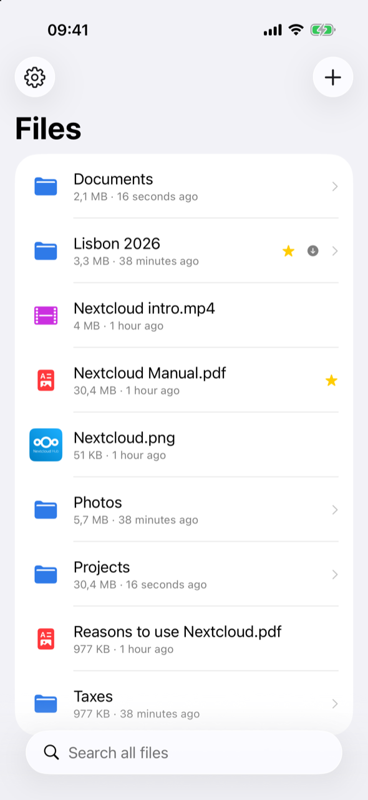
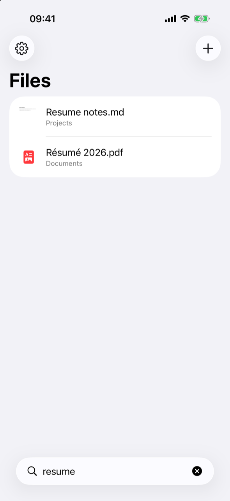
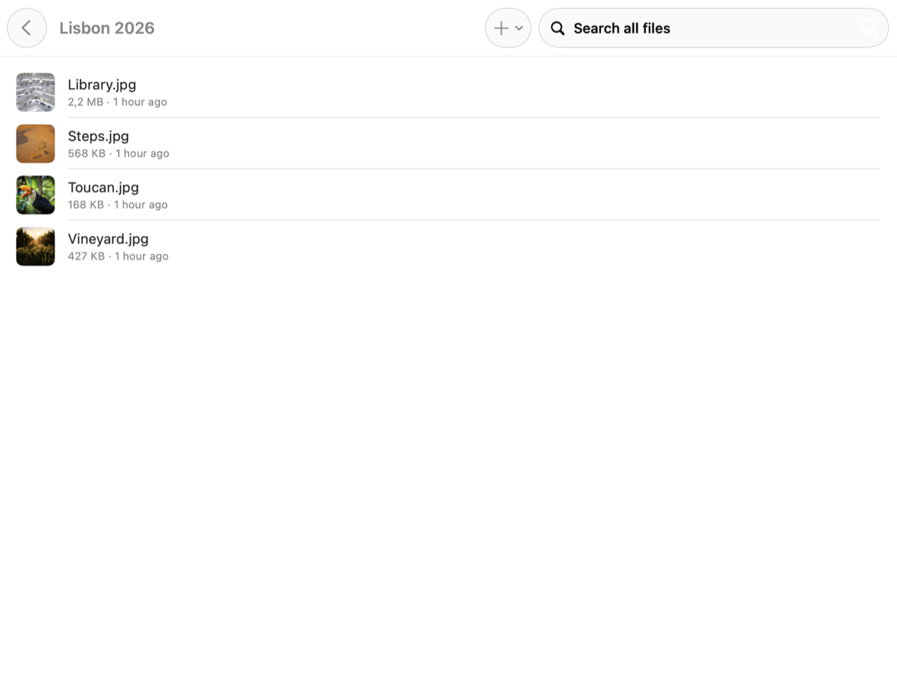

# Plume

A light, fast Nextcloud client for iPhone, iPad and Mac. Native SwiftUI, no
dependencies, only standard WebDAV and OCS on the wire.

**Website: [plume.bonout.com](https://plume.bonout.com)**

| iPhone | Search | Mac |
| --- | --- | --- |
|  |  |  |

- **Instant browsing**: folders open from a local mirror right away and refresh
  from the server in the background. Thumbnails come from the server and are cached.
  On iPhone and iPad, one screen: your folders and files, and the search.
- **Search as you type** across the whole account, ignoring case and accents
  ("resume" finds "Résumé"). The whole tree is mirrored locally; after the
  first pass, keeping it current costs one request when nothing changed.
- **Spotlight**: every file and folder can be found from Spotlight on iPhone,
  iPad and Mac. A result opens the folder, or the file in Quick Look.
- **Finder and Files**: a File Provider extension puts your Nextcloud next to
  iCloud Drive. Files are downloaded when opened, you can keep them downloaded,
  and edits made in any app are uploaded.
- **Save from any app**: use the share sheet (Plume), "Save to Files" → Plume,
  "Open in… Plume", drag and drop onto the window or the Dock icon, or the
  + button. Uploads go through an outbox, so an interrupted upload is retried and
  nothing is ever overwritten: a taken name becomes "name 2.ext".
- **Available offline**: pin a file or a whole folder. Pinned items stay up to
  date, and only folders whose etag changed are listed again.
- **Quick Look** for PDFs, images, video, audio and Office documents. On the
  Mac you can also open a file in its default app or reveal it in Finder, and
  changes sync back.
- Favorites synced with the server (Mac sidebar), public links, rename,
  delete (to the server's trash bin).
- Sign-in through Nextcloud Login Flow v2 (your browser, with two-factor
  authentication), or with an app password. The app password is stored in the
  Keychain and revoked on sign-out.
- Large files are uploaded in resumable chunks (Nextcloud chunked upload v2).

## Layout

| Path | What |
| --- | --- |
| `Packages/PlumeKit` | Nextcloud client (WebDAV, OCS, Login Flow), SQLite metadata store, local copies, sync by etags, outbox, plus `PlumeUI` (folder picker) |
| `App` | The SwiftUI app, shared by macOS and iOS |
| `FileProvider` | `NSFileProviderReplicatedExtension` (Finder / Files) |
| `ShareExtension` | "Save to Plume" from the share sheet |
| `Config` | Build settings and entitlements; your personal settings go in `Config/Local.xcconfig` (ignored by git) |
| `site` | The website, built by `site/build.py` and published by GitHub Pages (`.github/workflows/pages.yml`) |

## Build

Requirements: Xcode 16 or later and [XcodeGen](https://github.com/yonaskolb/XcodeGen) (`brew install xcodegen`).

```sh
scripts/configure.sh <your team id> <your bundle prefix>   # writes Config/Local.xcconfig
scripts/generate.sh                                         # Plume.xcodeproj
open Plume.xcodeproj
```

- **iPhone simulator**: works without an Apple account (ad hoc signing).
- **Mac**: the app and its extensions share the Keychain and an app group,
  which needs a development provisioning profile. Sign in under
  Xcode → Settings → Accounts. Spotlight also needs a signed build.
- **iPhone device**: also create the app group `group.<bundle prefix>` on
  developer.apple.com (Identifiers → App Groups) before the first build.

## Tests

```sh
cd Packages/PlumeKit && swift test   # unit tests
scripts/test-server.sh               # + against a throwaway Nextcloud in Docker
```

Debug builds can sign in from launch arguments, for testing against that
server: `-PlumeTestServer http://127.0.0.1:8099 -PlumeTestUser admin -PlumeTestPassword plume-test-pass`.

## Current limits

- Changes made elsewhere reach Finder / Files when Plume is opened, and every
  minute while it is open. There is no push from the server and no background
  refresh yet.
- Only one account.

## License

GPL-3.0-or-later.
