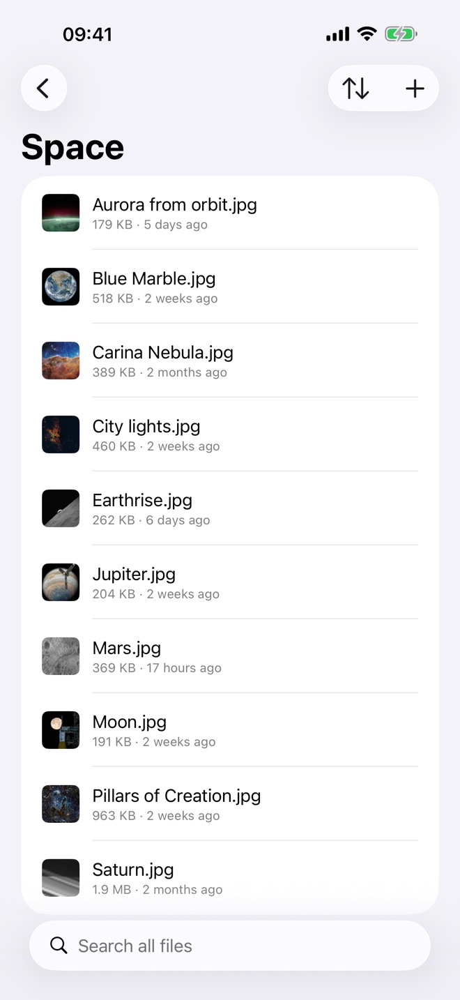
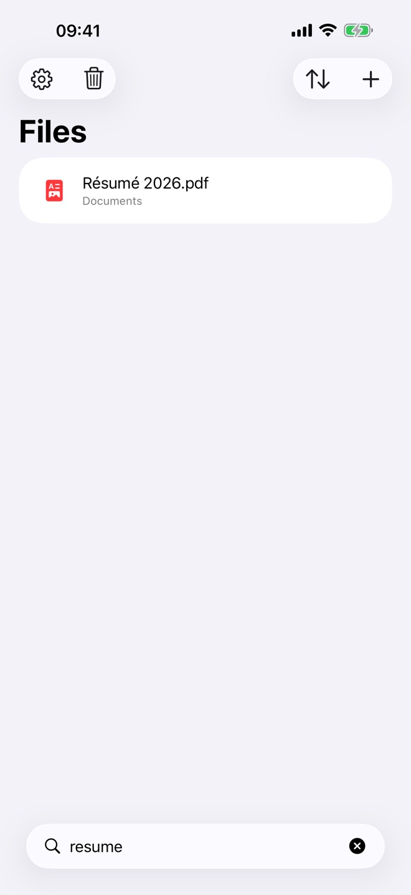
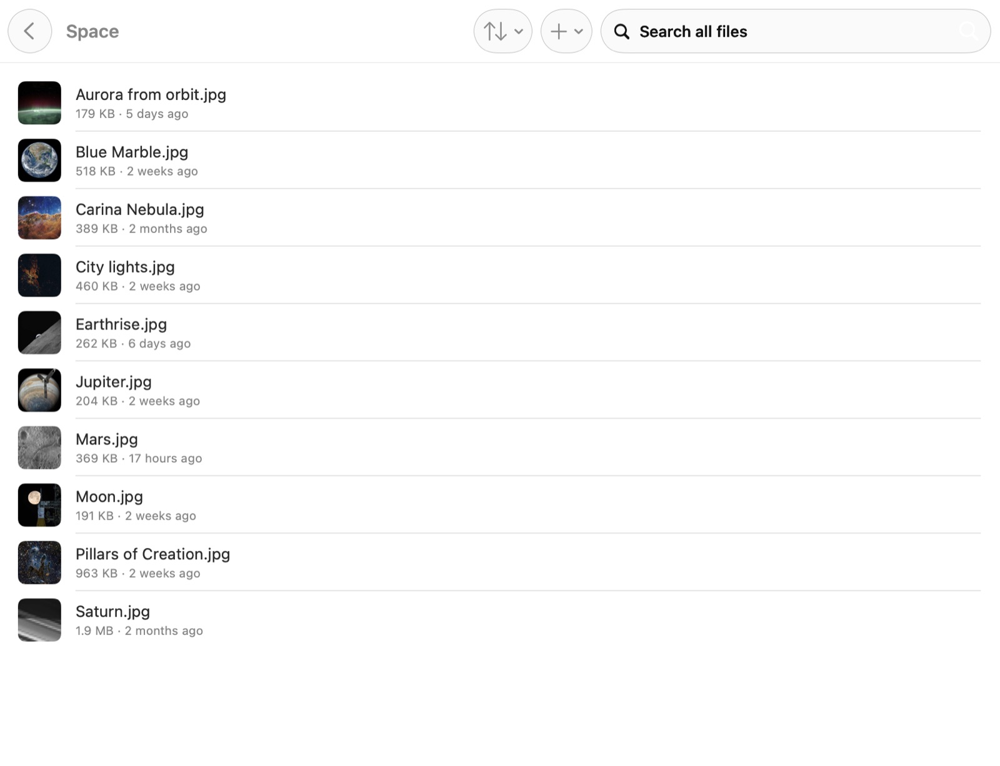

# Plume

A light, fast client for Nextcloud and any WebDAV server, on iPhone, iPad and
Mac. Native SwiftUI, no dependencies, only standard WebDAV and OCS on the wire.

**Website: [plume.bonout.com](https://plume.bonout.com)**

| iPhone | Search | Mac |
| --- | --- | --- |
|  |  |  |

- **Instant browsing**: folders open from a local mirror right away and refresh
  from the server in the background. Thumbnails come from the server and are cached.
  On iPhone and iPad, one screen: your folders and files, and the search.
- **Search as you type** across the whole account, ignoring case and accents
  ("resume" finds "Résumé"). The whole tree is mirrored locally; after the
  first pass, keeping it current costs one request when nothing changed.
- **Spotlight**: every file and folder can be found from Spotlight on iPhone,
  iPad and Mac. A result opens the folder, or the file in Quick Look.
- **Finder and Files**: a File Provider extension puts your Nextcloud next to
  iCloud Drive. Files are downloaded when opened, you can keep them downloaded,
  and edits made in any app are uploaded. The server's thumbnails show before
  anything is downloaded, and the item menu has Copy Public Link and
  Add to / Remove from Favorites. On the Mac, what you keep offline in Plume
  stays downloaded in Finder too.
- **Always current**: with the server's Client Push app (notify_push), a
  change anywhere reaches the app, Finder, Files and Spotlight within seconds.
  Otherwise the Mac checks every minute (with or without a window open), and
  the iPhone refreshes in the background when iOS allows it.
- **Save from any app**: use the share sheet (Plume), "Save to Files" → Plume,
  "Open in… Plume", drag and drop onto the window or the Dock icon, or the
  + button. Uploads go through an outbox, so an interrupted upload is retried and
  nothing is ever overwritten: a taken name becomes "name 2.ext".
- **Available offline**: pin a file or a whole folder. Pinned items stay up to
  date, and only folders whose etag changed are listed again.
- **Quick Look** for PDFs, images, video, audio and Office documents. On the
  Mac you can also open a file in its default app or reveal it in Finder, and
  changes sync back.
- **Sharing**: public links with a password, an expiry date, and editing or
  upload allowed; sharing with users and groups of the server, view only or
  editing. The server's rules (required password, maximum expiry) apply.
- **Versions and deleted files**: look at an earlier version of a file or make
  it current again; restore deleted files or delete them for good.
- **Uploads that go on** after you leave the app, with the system's progress
  on iOS 26.
- Favorites synced with the server (Mac sidebar), rename, delete (to the
  server's trash bin).
- Sign-in through Nextcloud Login Flow v2 (your browser, with two-factor
  authentication), or with an app password. The app password is stored in the
  Keychain and revoked on sign-out.
- Large files are uploaded in resumable chunks (Nextcloud chunked upload v2).

## Layout

| Path | What |
| --- | --- |
| `Packages/PlumeKit` | Nextcloud client (WebDAV, OCS, Login Flow), SQLite metadata store, local copies, sync by etags, outbox, plus `PlumeUI` (folder picker) |
| `App` | The SwiftUI app, shared by macOS and iOS |
| `FileProvider` | `NSFileProviderReplicatedExtension` (Finder / Files) |
| `ShareExtension` | "Save to Plume" from the share sheet |
| `Config` | Build settings and entitlements; your personal settings go in `Config/Local.xcconfig` (ignored by git) |
| `site` | The website, built by `site/build.py` and published by GitHub Pages (`.github/workflows/pages.yml`) |

## Build

Requirements: Xcode 16 or later and [XcodeGen](https://github.com/yonaskolb/XcodeGen) (`brew install xcodegen`).

```sh
scripts/configure.sh <your team id> <your bundle prefix>   # writes Config/Local.xcconfig
scripts/generate.sh                                         # Plume.xcodeproj
open Plume.xcodeproj
```

- **iPhone simulator**: works without an Apple account (ad hoc signing).
- **Mac**: the app and its extensions share the Keychain and an app group,
  which needs a development provisioning profile. Sign in under
  Xcode → Settings → Accounts. Spotlight also needs a signed build.
- **iPhone device**: also create the app group `group.<bundle prefix>` on
  developer.apple.com (Identifiers → App Groups) before the first build.
- **TestFlight**: create the app in App Store Connect (iOS and macOS, bundle
  identifier `<bundle prefix>`), then `scripts/testflight.sh ios` (or `mac`)
  archives and uploads it, with the Apple account signed in to Xcode or an App
  Store Connect API key.
  The TestFlight workflow (Actions tab) does the same from GitHub, with the
  secrets listed in `.github/workflows/testflight.yml`.

## Tests

```sh
cd Packages/PlumeKit && swift test   # unit tests
scripts/test-server.sh               # + against a throwaway Nextcloud and a WebDAV server (rclone) in Docker
```

Debug builds can sign in from launch arguments, for testing against that
server: `-PlumeTestServer http://127.0.0.1:8099 -PlumeTestUser admin -PlumeTestPassword plume-test-pass`.

## Current limits

- Without notify_push on the server, changes made elsewhere reach an iPhone's
  Files app and Spotlight only when iOS runs the background refresh (it
  decides when, from how the app is used) or when Plume is opened.
- Only one account.
- On a plain WebDAV server (not Nextcloud): sign-in with a user name and
  password, no thumbnails from the server, favorites, sharing, versions or
  trash; uploads go in one request; changes are found by listing every known
  folder, since such servers don't propagate folder etags.

## License

GPL-3.0-or-later.
